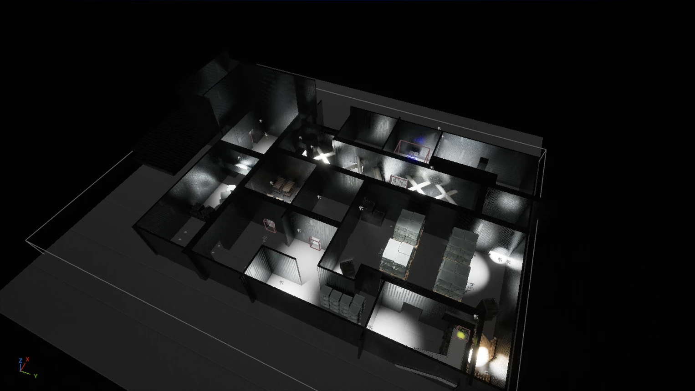
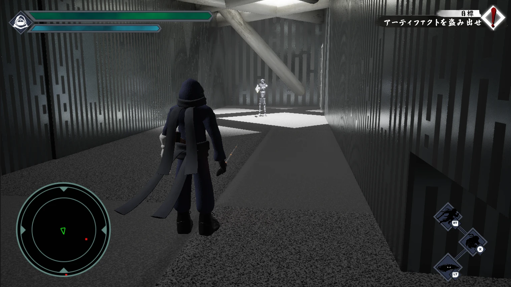
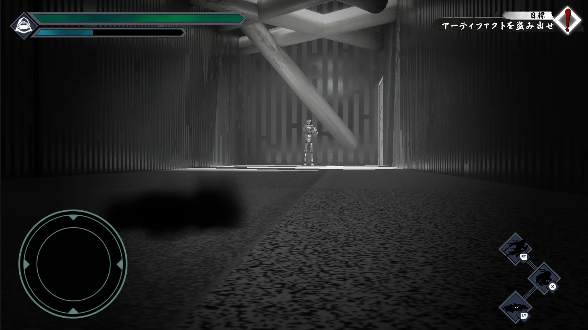

# Sneak Portfolio

影に潜り、敵の視界を避けながら宝物を盗み、脱出を目指す、チーム制作のステルスアクションです(Unreal Engine 5)。

ポートフォリオ用に、自分が書いた、または修正したソースを公開するリポジトリです。ソースは `Source/` にあります。ゲーム全体のソースは、[チーム制作のリポジトリ](https://github.com/dai278/StealthAction_Git)を参照してください。

## 制作情報

| 項目 | 内容 |
|---|---|
| 制作 | 5 名(プログラマー 4 名、デザイナー 1 名) |
| 担当 | プログラマー(影状態の画面効果、ステージ 5 の霧の演出、敵エフェクトの不具合修正、UE5.5 から 5.7 への移行対応) |
| 期間 | 2025 年 11 月 20 日〜2026 年 2 月 25 日(その後も継続して改善) |
| ジャンル | ステルスアクション |
| 開発環境 | Unreal Engine 5.7(制作開始時は 5.5)/ C++・Blueprint / Windows 11 |
| 作成者 | 日本電子専門学校 ゲーム制作研究科 大川翔生 |

## 画面

### ステージ 5

ステージ 5 を、Unreal Editor のビューポートで上から見たところです(ライティングあり)。

### 影状態の画面効果(`ShadowVisionComponent`)

| 影に入る前 | 影に入った後 |
|---|---|
|  |  |

Unreal Editor で実行(Play In Editor)した画面です。影に入ると、画面の周辺が暗くなり、視野が狭まります。この効果は、私が担当しました。

### プレイ動画

[プレイ動画(Google Drive、2 分 37 秒)](https://drive.google.com/file/d/1hO3ireUyzyyQeZPExDxrKaMpDCBVQf5i/view?usp=sharing)

チームで制作したゲーム全体のプレイ動画です。タイトルから、ステルスで進み、脱出するまでを録画しています。

## 担当内容

プログラマーとして、影状態の画面効果、ステージ 5 の演出、敵エフェクトの修正、UE5.7 への移行を担当しました。制作の初期には、プレイヤーの移動入力とカメラも変更しています。

**影状態の画面効果(2026 年 10 月)**
- `ShadowVisionComponent`: 影に入ると画面の周辺が暗くなり、視野が狭まる効果を、なめらかに掛ける C++ のコンポーネント(自作)
- 専用のポストプロセスマテリアル `M_ShadowVision`、`PlayerCharacterBP` への組み込みと値の調整
- 影に入ったときのアウトラインと暗闇のマテリアル `Outline_MF` / `Outline_post`(2025 年 12 月)

**ステージ 5 の演出(2026 年 10 月)**
- Fog の調整、霧のアセット `BP_MistBank`、`MistMask` の追加

**敵エフェクトの不具合修正(2026 年 2 月)**
- 敵のエフェクトで起きていたクラッシュの原因になりうる処理を修正(`Enemy_Effect_1〜4`、`Enemy_EffectManager`、`EnemyBase`)
- 敵の死亡演出の時間(`m_deadTime_Limit`)を 5.0 秒から 3.6 秒に変更

**プレイヤーの移動とカメラ(2026 年 1 月)**
- 縦と横の 2 つの移動入力を、1 つの `moveIA` にまとめる
- 肩越しの三人称カメラ(スプリングアーム、ピッチの制限)

**UE5.5 から 5.7 への移行(2026 年 7 月)**
- `StealthAction.uproject` の `EngineAssociation` を 5.5 から 5.7 へ変更
- エディタ用ターゲット(`StealthActionEditor.Target.cs`)の `BuildSettingsVersion` を V5 から V6 へ変更
- `.vsconfig`(Visual Studio の構成)を更新
- `std::function` を使う 5 つのヘッダーに `#include <functional>` を追加
- `ItemKey.h` のマクロ `CreateNoiseEventCallback`(`NoiseListenerComponent.h` にも同名の定義があるもの)と、`PushMoveReset.cpp` の不要な include を整理
- デバッグ用の `UE_LOG` 93 行をコメントアウトまたは削除
- 変更は 37 ファイルにわたります。移行のためだけに触ったファイルは、このリポジトリには載せていません。

**修正した Content(ファイルは載せていません)**

| ファイル | 修正内容 |
|---|---|
| `Level/Stage/stage_5.umap` | Fog の調整、霧の追加、影状態の画面効果の追加に合わせた修正 |
| `Level/Stage/test.umap` | 影状態の画面効果の追加に合わせた修正 |
| `Player/BP/PlayerCharacterBP` | 影状態の画面効果の組み込みと調整、移動とカメラの変更に合わせた設定 |
| `Input/PlayerIMC` | `moveIA` の追加に合わせた入力設定 |

## 他のメンバーが作成したコードについて

次のファイルは、他のメンバーが作成したコードを含みます。各メンバーの許可を得て、ファイル全体を掲載しています。**私が書いた部分は、ファイルの一部です。**

| ファイル | 作成・担当 | 私が修正した内容 |
|---|---|---|
| `Enemy_Effect_1〜4.cpp`、`Enemy_EffectManager.h/.cpp` | 他のメンバー | エフェクトのプールの事前生成、取得・再利用の処理を修正(約 4 割の行) |
| `EnemyBase.h/.cpp` | 担当表記: 廣川菖 | 敵とエフェクトの連携(状態が変わったときだけエフェクトを切り替える)、死亡時間の変更(全体の約 2%) |
| `PlayerCharacter.h/.cpp` | 担当表記: 日髙(プログラムリーダー) | 移動入力とカメラの変更(全体の 1〜2%)。現在のプレイヤーは、その後に日髙がステートクラスへ分離・拡張したものです |

## 使用技術

- Unreal Engine 5.7(C++、Blueprint)
- ポストプロセスマテリアル、カメラの `PostProcessSettings`
- Enhanced Input
- Git / Git LFS

## Source について

載せているのは、**自分が書いた、または修正したソースだけ**です。ゲーム全体(アセット、マップ、ほかのクラス)は入っていないため、このリポジトリだけではビルドできません。

| フォルダ | 内容 |
|---|---|
| `Source/StealthAction/Public/Shadow`、`Private/Shadow` | `ShadowVisionComponent`(自作) |
| `Source/StealthAction/Public/Enemy_Effect`、`Private/Enemy_Effect` | 敵エフェクトのプール(他のメンバーが作成、私が修正) |
| `Source/StealthAction/Public/Enemy`、`Private/Enemy` | `EnemyBase`(他のメンバーが作成、私が修正) |
| `Source/StealthAction/PlayerCharacter` | `PlayerCharacter`(日髙が引き継ぎ・拡張、私が一部を変更) |

掲載にあたって、次の 2 点を変えています。コードの内容は変えていません。
- 読みやすくするため、文字コードを UTF-8(BOM 付き)に変換しました(元は Shift-JIS のものがありました)。
- `EnemyBase.h/.cpp` と `ShadowVisionComponent.h/.cpp` の先頭にあった、学籍番号を削除しました。

## 実装上の工夫

### 影状態の画面効果(ShadowVisionComponent)

- 影の出入りは、プレイヤーが公開している通知(`OnEnteredShadow` / `OnExitedShadow`)を受け取るだけです。通知を送る影の処理(日髙が実装)には手を入れません。
- 入るときと出るときで別の時間(既定は 0.4 秒と 0.3 秒)を使い、一定の速さで強さを変えたあと、緩急をつけて(ease in-out)反映します。
- 効果が動いている間だけ `Tick` を有効にします。完全に消えたら、カメラに追加した効果と上書きした設定を、元に戻します。
- 専用マテリアル(強さのパラメータ `Strength`)がなくても動きます。その場合は、標準のビネットと彩度の低下で代用します。
- `EndPlay` で通知の登録を解除し、効果をカメラから外します。

### 敵エフェクトのプール(修正)

- エフェクトの事前生成を 1 つのテンプレート関数(`PrewarmPoolTyped`)にまとめ、クラスが未設定のときはログを出して生成を飛ばします。
- 取得したときにすぐ表示状態にして、同じフレームで同じエフェクトを二重に取得しないようにします。
- 再利用のときに、前回の自動消去のタイマーを解除します。ターゲットが無効なときは、アタッチしません。
- 敵の状態が変わったときだけエフェクトを切り替え、表示中のエフェクトは 1 つだけ管理します。

## 注意事項

- **閲覧目的で公開しています。** コードの無断転載・再利用はご遠慮ください。LICENSE は置いていません。
- 他のメンバーが作成したコードは、そのメンバーの許可を得て掲載しています。

## リンク

- [プレイ動画(Google Drive)](https://drive.google.com/file/d/1hO3ireUyzyyQeZPExDxrKaMpDCBVQf5i/view?usp=sharing)
- [チーム制作のリポジトリ(ゲーム全体)](https://github.com/dai278/StealthAction_Git)
